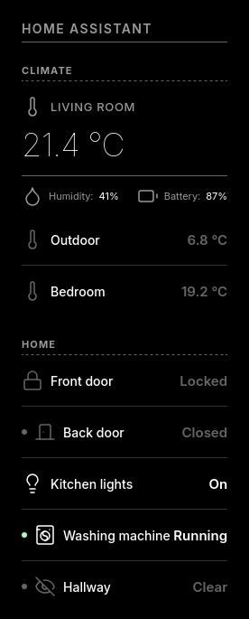

# mirrordash-homeassistant

A Home Assistant data-fetcher module for MirrorDash. It connects to a local Home Assistant REST API, retrieves the states of configured entity IDs, and presents them in a beautiful, responsive HUD layout.

## Features
- **Concurrent API Fetching**: Retrieves state data for all configured entities in parallel to ensure extremely fast refreshes.
- **Multiple Layout Options**: Choose between `"detailed"` (large primary reading and nested metadata footer) and `"compact"` (dense vertical layout with inline metadata).
- **Group Entities & Mix layouts**: Group your entities into custom categories/sections. Each entity follows the module's Layout Style unless you pick `"detailed"` or `"compact"` for it.
- **Nested Telemetry Extraction**: Finds each entity's battery, humidity, signal strength and voltage (its own attributes or a companion sensor); tick under **Extra Readings** which of them each entity shows (MirrorDash 0.13 or newer).
- **Default Icon Resolution**: Automatically resolves default Lucide icons based on entity domain and unit type (e.g. thermometer for temperature, droplet for humidity, lightbulb for lights) if no custom icon is specified.
- **Responsive Layout**: Adjusts layout alignment (left/right snapping) dynamically based on the mirror region it is placed in, and scales cleanly without fixed pixel widths.
- **Connection Error Warning**: Gracefully handles unreachable instances or authorization errors.

## Installation

On the mirror's admin page, open **Modules**: the module is in the list, install it with one click.
Or paste `git+https://github.com/Menturan/mirrordash-homeassistant.git` under **Modules → Add modules → Install from a Git URL or folder**.

Developing it: `uv run pytest` runs its tests, and `uvx mirrordash-sdk validate .` checks it.

## Screenshot

## License
[MIT](LICENSE)
