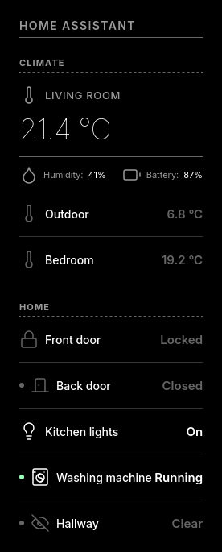

# mirrordash-homeassistant

A Home Assistant data-fetcher module for MirrorDash. It connects to a local Home Assistant REST API, retrieves the states of configured entity IDs, and presents them in a beautiful, responsive HUD layout.

## Features
- **Concurrent API Fetching**: Retrieves state data for all configured entities in parallel to ensure extremely fast refreshes.
- **Multiple Layout Options**: Choose between `"detailed"` (large primary reading and nested metadata footer) and `"compact"` (dense vertical layout with inline metadata).
- **Group Entities & Mix layouts**: Group your entities into custom categories/sections. Each entity follows the module's Layout Style unless you pick `"detailed"` or `"compact"` for it.
- **Extra Readings**: each entity lists its other readings in the form (its numeric attributes and the sensors on the same Home Assistant device: battery, humidity, signal, pressure, ...). Tick which ones show under its value; a new entity has them all ticked. Needs MirrorDash 0.19 or newer.
- **Default Icon Resolution**: Automatically resolves default Lucide icons based on entity domain and unit type (e.g. thermometer for temperature, droplet for humidity, lightbulb for lights) if no custom icon is specified.
- **Responsive Layout**: Adjusts layout alignment (left/right snapping) dynamically based on the mirror region it is placed in, and scales cleanly without fixed pixel widths.
- **Connection Error Warning**: Gracefully handles unreachable instances or authorization errors.

## Settings

- **Home Assistant URL** and **Access Token** are shared: type them once, every Home Assistant card uses them. Each card can switch on **Own value** to use another Home Assistant.
- **Extra Readings** (per entity) are ticked in the form, found by asking Home Assistant. Rows saved with the old Extra Readings list show none until ticked again.

## Todo lists

Add a todo list (an entity ID starting with `todo.`, e.g. `todo.shopping_list`) like any other entity. Its row shows the list's name and the number of open items; the items are drawn under it, each with a ring bullet, in both looks. Open items come first, in Home Assistant's order, then completed ones (struck through and dimmed) when you switch them on. A due date shows small at the right of the item: `today`, `tomorrow`, a weekday within the next 6 days, else the day and month, plus the time when the item has one. An open item that is overdue is brighter and starts with `!`.

Four options per list, in the entity's settings:

- **Show completed items** (default off).
- **Max items** (default 5): at most this many items are drawn, completed ones are cut first, the rest is a line like `+3 more`.
- **Columns** (default Auto): Auto fits as many columns as there is room for (at least about 11rem each, at most 4); 1 to 4 sets the number. Items read top to bottom, then the next column.
- **Show items due within** (days, default empty): an item with a due date appears only when its due date is at most this many days after today (0: only items due today). Overdue items and items without a due date are always shown, completed items follow the same rule, and items left out by it are not counted in `+N more`. The open count on the row is still Home Assistant's own.

The long-lived access token needs nothing extra. The items are not shared with other modules (the open count is, as for any entity). To see a list in the admin preview, add `todo.shopping_list` as an entity.

## Sharing readings with other modules

Two checkboxes per entity:

- **Show on the Mirror** (default on): untick to keep the entity out of the card. If no entity is left to draw, the card is hidden.
- **Share with Other Modules** (default off): every update (each Update Interval, 30 seconds by default) sends the public event `mirrordash_homeassistant.<entity id>`, for example `mirrordash_homeassistant.sensor.outdoor_temperature`. An entity that is neither shown nor shared isn't fetched at all.

A sensor with a number sends:

```json
{"value": 3.4, "unit": "°C", "name": "Outdoor temperature", "kind": "temperature"}
```

Anything else (on/off, open, unavailable, ...) sends:

```json
{"state": "on", "name": "Front door", "kind": "door"}
```

`name` is the custom name, else Home Assistant's friendly name, else the entity ID. `kind` is what the module takes the entity to be (`temperature`, `humidity`, `door`, `other`, ...). Any module can subscribe to the event, for example Weather's outdoor temperature. Nothing is sent from the admin page's preview, and an entity ID that doesn't fit an event name is skipped with a warning in the log.

## Installation

On the mirror's admin page, open **Modules**: the module is in the list, install it with one click.
Or paste `git+https://github.com/Menturan/mirrordash-homeassistant.git` under **Modules → Add modules → Install from a Git URL or folder**.

Developing it: `uv run pytest` runs its tests, and `uvx mirrordash-sdk validate .` checks it.

## Screenshot



## License
[MIT](LICENSE)
